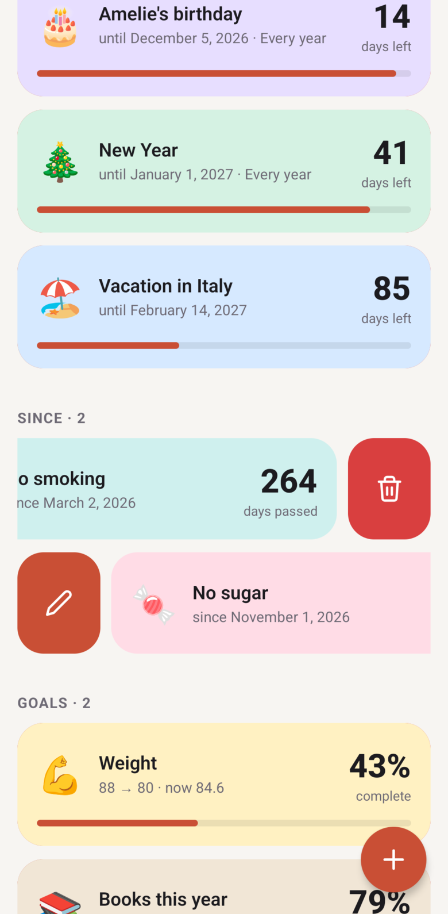
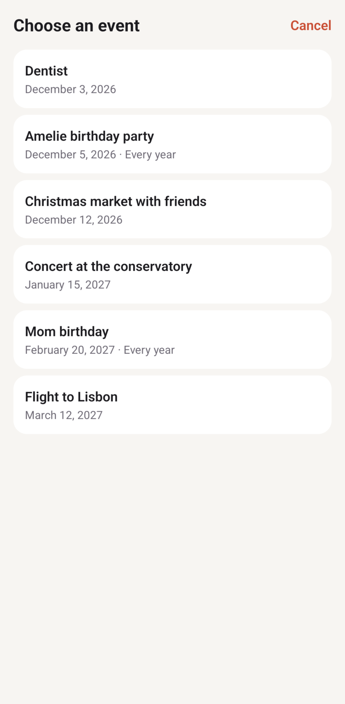
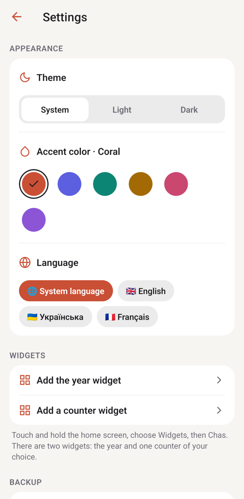
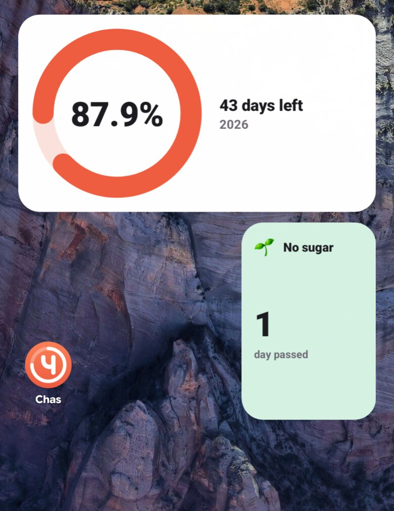

# Chas


**Chas** (from the Ukrainian word «час», "time") is a free, ad-free app that counts days to events, days since events, and progress to goals.
It runs on Android and iOS. Built with React Native, Expo and Expo Router.

## Screenshots

<table>
  <tr>
    <td></td>
    <td></td>
    <td></td>
  </tr>
  <tr>
    <td align="center">Year card and counters</td>
    <td align="center">Swipe to edit or delete</td>
    <td align="center">Counter details</td>
  </tr>
  <tr>
    <td></td>
    <td></td>
    <td></td>
  </tr>
  <tr>
    <td align="center">New counter</td>
    <td align="center">Choose an event from the calendar</td>
    <td align="center">Settings</td>
  </tr>
</table>



## Features

- **Year countdown** — how much of the year has passed, days and weekends left. The date at the top shows the year.
- **Countdown** — days left until a date, with a progress bar. It can repeat every month or every year (birthdays, bills).
- **Days since** — count days since a date, for habits. You can start again from today.
- **Goal** — progress from a start value to a target value, for example weight 88 → 80.
- **Reminders** (Android) — for a countdown: on the day, 1 day before or 1 week before. For all counters: on a date that you choose. Each counter has its own reminder time. Tap the notification to open the counter.
- Counters in groups: upcoming (nearest first), since, goals and past.
- Details: weeks and days left, weekends left, days passed of the total.
- Create and edit counters on the card itself: type the name in the card, tap the icon to change it,
  and choose one of 12 card colors under the card. The date, the repeat and the reminder are in one panel, with quick dates.
- **From the calendar** — choose an event from the phone calendar, and Chas makes a countdown with its name and date.
  Yearly and monthly events, for example birthdays, become repeating countdowns. Chas only reads the calendar. It never changes it.
- Swipe a counter on the home screen: to the right to edit it, to the left to delete it.
- Android home screen widgets: the year, and one counter of your choice. Add them from Settings or from the home screen.
  Make a widget wide, and the text moves beside the ring or the number.
- Native date and time pickers on Android and iOS.
- Light, dark and system themes, and six accent colors.
- English, Ukrainian and French. The app follows the phone language, or you can choose one in Settings.
- All data stays on the device (AsyncStorage). The calendar events stay on the device too.

## Install

Download the latest `.apk` file from [Releases](https://github.com/vadym-loik/chasApp/releases) and open it on your Android phone.
Android asks you to allow installs from this source. The APK supports 64-bit ARM phones (`arm64-v8a`).

## Run

```bash
npm install
npm start          # scan the QR code with Expo Go on Android or iOS
npm run android    # open in an Android emulator or a connected device
npm run ios        # open in the iOS simulator (macOS only)
```

Widgets and the calendar do not work in Expo Go. To test them, make a development build (`npx expo run:android`) or build the APK (see below).

## Checks

```bash
npm run typecheck
npm run lint
npm test
```

## Release

GitHub Actions builds the releases:

- **CI** (`.github/workflows/ci.yml`) runs typecheck, lint and tests on each push to `main` and each pull request.
- **Release** (`.github/workflows/release.yml`) runs on a tag `vX.Y.Z`. It builds and signs the APK and creates a draft release.

To make a release:

1. Raise `expo.version` and `expo.android.versionCode` in `app.json`, and `version` in `package.json`.
2. Commit, then `git tag -a vX.Y.Z -m "Chas X.Y.Z"` and `git push origin main vX.Y.Z`. The tag must match `expo.version`.
3. When the workflow ends, edit the notes of the draft release and publish it.

The signing key is in the GitHub environment `release`. It accepts only `v*` tags.

## Build the APK on your computer

Needs JDK 17 and the Android SDK.

```bash
npx expo prebuild --platform android --clean
cd android && ./gradlew assembleRelease -PreactNativeArchitectures=arm64-v8a
```

`prebuild` changes the `android` and `ios` scripts in `package.json`. Put them back before you commit.
Then sign `android/app/build/outputs/apk/release/app-release.apk` with your release key (`apksigner`).

## Logo

`scripts/generate-icons.sh` generates all icons (app icon, Android adaptive icon, splash, favicon) from one SVG design.
It needs `rsvg-convert`.

## Project structure

```
src/
├── app/            # Screens (Expo Router)
│   ├── _layout.tsx # Providers, stack navigator, gestures, reminders
│   ├── index.tsx   # Year countdown and counter groups
│   ├── edit.tsx    # Create or edit a counter
│   ├── [id].tsx    # Counter details
│   └── settings.tsx# Appearance (theme, accent color, language), widgets, backup, support
├── components/     # UI parts
├── models/         # TypeScript types
├── i18n/           # Translations (en, uk, fr)
├── services/       # Storage (AsyncStorage), reminders (notifications), backup and calendar
├── theme/          # Colors
├── utils/          # Day, year, percent and reminder calculations
├── widgets/        # Android widgets and their configuration screen
└── AppProvider.tsx # Settings, theme and language for all screens
index.ts            # Entry: Expo Router and widget registration
.github/workflows/  # CI and release builds
```

## About the screenshots

The screenshots come from the Android emulator with demo data, with the changes after version 1.4.0.
The widget picture comes from an Android phone with version 1.3.0.
The web build has no reminders and no widgets. It uses the browser date and time inputs.

## Roadmap

- Repeating reminders, for example each week to update a goal.
- Calendar view of all events.
- Tags and pinned counters.

## License

[MIT](LICENSE) © 2026 Vadym Loik
