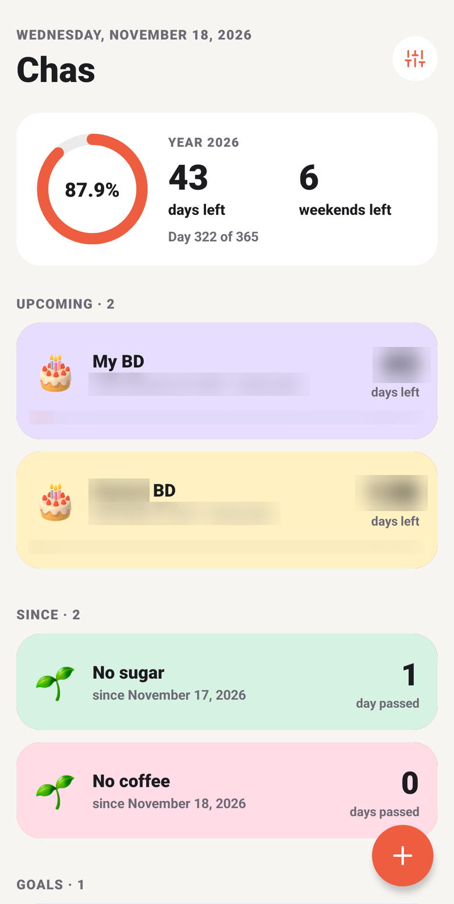
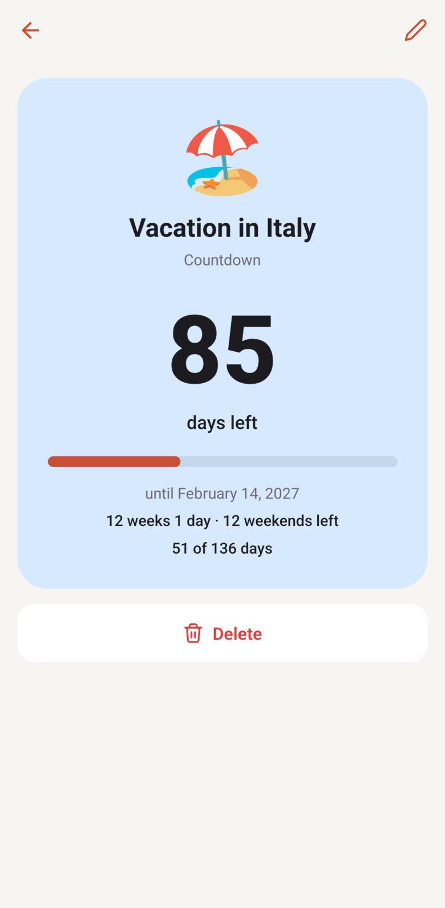
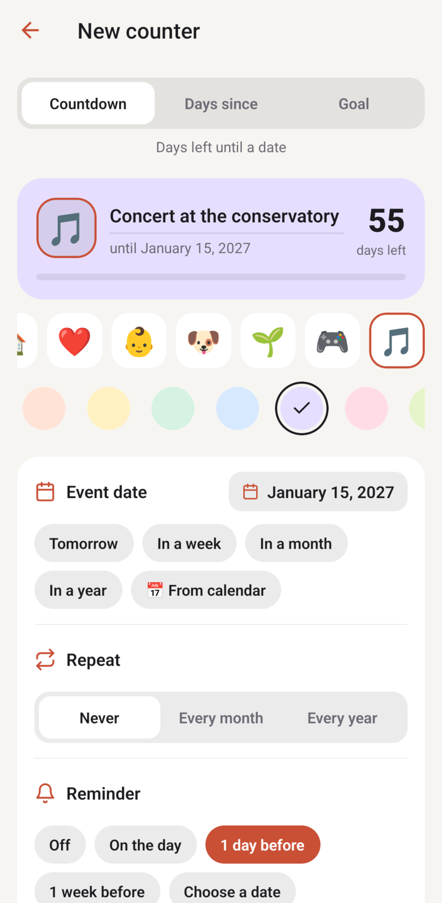
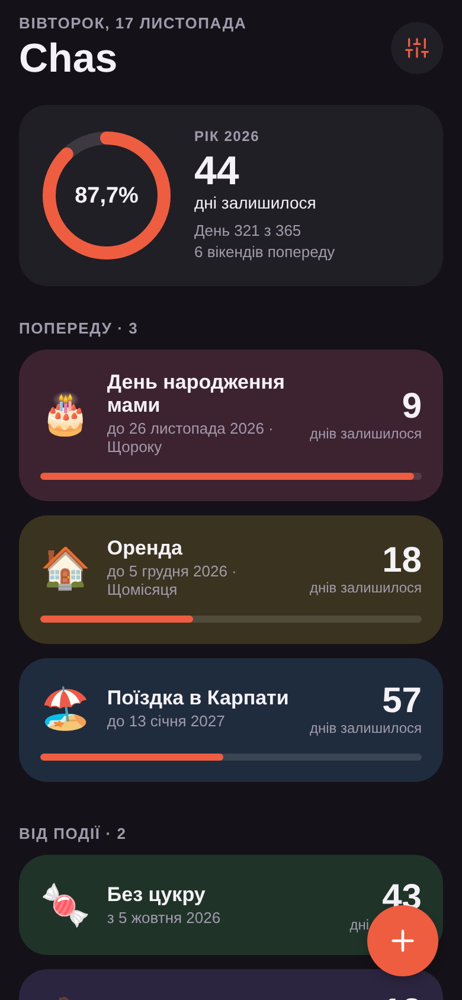
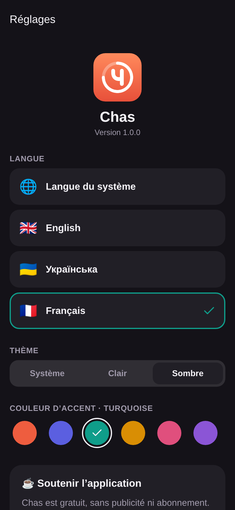
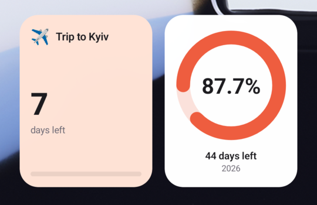

# Chas


**Chas** (from the Ukrainian word «час», "time") is a free, ad-free app that counts days to events, days since events, and progress to goals.
It runs on Android and iOS. Built with React Native, Expo and Expo Router.

## Screenshots

<table>
  <tr>
    <td></td>
    <td></td>
    <td></td>
    <td></td>
    <td></td>
  </tr>
  <tr>
    <td align="center">Year countdown and counters</td>
    <td align="center">Details of a yearly event</td>
    <td align="center">New counter</td>
    <td align="center">Dark theme, Ukrainian</td>
    <td align="center">Settings, French</td>
  </tr>
</table>



## Features

- **Year countdown** — how much of the year has passed, days and weekends left.
- **Countdown** — days left until a date, with a progress bar. It can repeat every month or every year (birthdays, bills).
- **Days since** — count days since a date, for habits. You can start again from today.
- **Reminders** (Android) — a notification on the day of a countdown, 1 day before or 1 week before. You choose the time in Settings. Tap the notification to open the counter.
- **Goal** — progress from a start value to a target value, for example weight 88 → 80.
- Counters in groups: upcoming (nearest first), since, goals and past.
- Details: weeks and days left, weekends left, days passed of the total.
- Create and edit counters with a live preview, quick dates, emoji and card colors.
- Swipe a counter on the home screen: to the right to edit it, to the left to delete it.
- Android home screen widgets: the year, and one counter of your choice. Add them from Settings or from the home screen.
- Native date picker on Android and iOS.
- Light, dark and system themes, and six accent colors.
- English, Ukrainian and French. The app follows the phone language, or you can choose one in Settings.
- All data stays on the device (AsyncStorage).

## Install

Download the latest `.apk` file from [Releases](https://github.com/vadym-loik/chasApp/releases) and open it on your Android phone.
Android asks you to allow installs from this source. The APK supports 64-bit ARM phones (`arm64-v8a`).

## Run

```bash
npm install
npm start          # scan the QR code with Expo Go on Android or iOS
npm run android    # open in an Android emulator or a connected device
npm run ios        # open in the iOS simulator (macOS only)
```

Widgets do not work in Expo Go. To test them, build the APK (see below).

## Checks

```bash
npm run typecheck
npm run lint
npm test
```

## Build the APK

Needs JDK 17 and the Android SDK.

```bash
npx expo prebuild --platform android
cd android && ./gradlew assembleRelease -PreactNativeArchitectures=arm64-v8a
```

Then sign `android/app/build/outputs/apk/release/app-release.apk` with your release key (`apksigner`).

## Logo

`scripts/generate-icons.sh` generates all icons (app icon, Android adaptive icon, splash, favicon) from one SVG design.
It needs `rsvg-convert`.

## Project structure

```
src/
├── app/            # Screens (Expo Router)
│   ├── _layout.tsx # Providers and stack navigator
│   ├── index.tsx   # Year countdown and counter groups
│   ├── edit.tsx    # Create or edit a counter
│   ├── [id].tsx    # Counter details
│   └── settings.tsx# Language, theme, accent color, support
├── components/     # UI parts
├── models/         # TypeScript types
├── i18n/           # Translations (en, uk, fr)
├── services/       # Storage (AsyncStorage)
├── theme/          # Colors
├── utils/          # Day, year and percent calculations
├── widgets/        # Android widgets and their configuration screen
└── AppProvider.tsx # Settings, theme and language for all screens
index.ts            # Entry: Expo Router and widget registration
```

## About the screenshots

The app screenshots come from the web build with demo data, at phone size (390×844, 2×).
The widget screenshot comes from an Android 16 emulator.
The web build uses the browser date input. Android and iOS use the native date picker.

## Roadmap

- Reminders before an event.
- Calendar view of all events.
- Tags and pinned counters.
- GitHub Actions: build an `.apk` on each release.

## License

[MIT](LICENSE) © 2026 Vadym Loik
